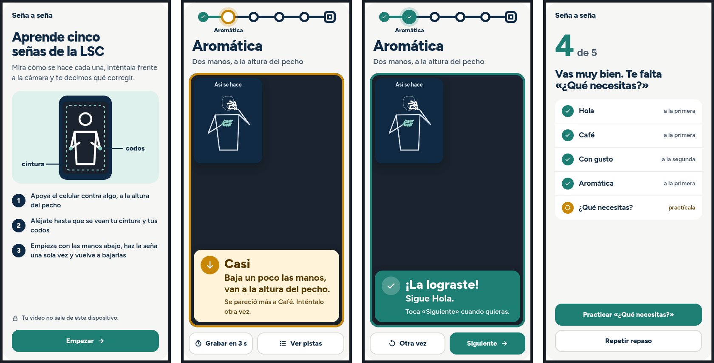

# Seña a seña - reconocimiento de cinco señas de la LSC

Un clasificador basado en puntos de manos y cuerpo extraídos de video, con una aplicación de práctica con cámara para **Café, Aromática, Hola, ¿Qué necesitas? y Con gusto**, cinco señas aisladas de la Lengua de Señas Colombiana. Permite mirar una guía, intentar una seña y recibir una indicación concreta para el siguiente intento. Está orientada a personas oyentes que empiezan a familiarizarse con este vocabulario.

El modelo seleccionado obtuvo **98,49 % de accuracy LOSO: 1.108 aciertos en 1.125 clips de desarrollo**, dejando una persona fuera del entrenamiento en cada partición. Son solo tres personas y los rasgos se diseñaron mirando sus errores: el resultado no garantiza ese desempeño con alguien nuevo. **No es una puntuación oficial del reto.**

El proyecto reconoce clips delimitados de cinco clases. No traduce conversaciones ni reconoce toda la LSC; tampoco se ha evaluado su eficacia como herramienta de enseñanza.

## Ver la experiencia

[](demo/README.md)

*Pantallas de la aplicación existente. Cámara y respuestas simuladas para ilustrar el recorrido, con guías dibujadas y anonimizadas. No representan resultados de una prueba real.*

- **[Abrir la demo alojada](https://sena-a-sena.onrender.com/)**: el acceso autenticado y la API se comprobaron el 26 de noviembre de 2026 (UTC); requiere contraseña, compartida por separado con participantes autorizados. El enlace no equivale a acceso público a la práctica. Consulta el [estado comprobado y los requisitos](demo/README.md#acceso-y-disponibilidad).
- **[Inspeccionar o ejecutar la demo](demo/README.md)**: interfaz, API FastAPI, activos necesarios y pasos locales. Los pesos y las guías del dataset no se distribuyen en este repositorio.
- **Privacidad:** el navegador convierte el video en landmarks; estos puntos **se envían al servidor**, donde se ejecutan el modelo y la corrección. La aplicación no envía el video de la cámara.

## Resultados y qué significan

| Evaluación | Resultado | Interpretación |
|---|---:|---|
| MLP sobre estadísticas sin estructura anatómica | 60,98 % LOSO | Línea base: 686/1.125; una semilla. |
| TCN sobre secuencias sin estructura anatómica | 48,89 % LOSO | Resultado negativo conservado; una semilla. |
| Candidato `v4_contact_bimanual` | **98,49 % LOSO** | 1.108/1.125; promedio de probabilidades de tres MLP, semillas 17/29/43. |
| Análisis anidado de selección, 24 variantes | **97,99 %** | Promedia los empates internos. Ajusta la selección entre variantes, pero no el optimismo del diseño de rasgos informado por errores de las mismas tres personas. |
| Cámara propia, una persona oyente | 49/60 a frecuencia nativa y 27/30 | Primera tanda: 48/60 tras remuestrear a 24 fps. Dos encuadres; ensayo exploratorio, no validación de generalización. |
| PyTorch frente a NumPy, 90 clips propios | Misma clase en 90/90; diferencia máxima de probabilidad 1,79 × 10⁻⁷ | Equivalencia numérica en esos clips, no exactitud sobre otras personas. |

La evolución incluye cambios de representación, normalización, aumentos y ensamble; no es una comparación controlada que atribuya toda la mejora a una sola decisión. LOSO y el análisis anidado usan **train**, no las etiquetas ocultas de test. La entrega está preparada y reproducida localmente; **no consta envío confirmado ni resultado oficial**.

El **[reporte técnico en PDF](docs/09_reporte_tecnico.pdf)** reúne método, análisis de errores y limitaciones. Su línea base de 60,09 % corresponde al ensamble de tres semillas; el 60,98 % de esta tabla es la ejecución inicial de una semilla. La edición pública conserva la autoría del equipo y incluye la figura anonimizada de la aplicación, con sus estados simulados identificados como ilustración.

El [registro de resultados](docs/07_results_and_publication_protocol.md#lectura-rápida-del-resultado-actual) conserva procedencia, resultados por persona y alternativas descartadas. La confianza del clasificador es una puntuación del modelo: el umbral de la demo no demuestra calibración ni fiabilidad lingüística.

## Decisiones que se pueden inspeccionar

| Decisión | Por qué importa | Implementación y evidencia |
|---|---|---|
| Evaluar por persona, con escalado y aumentos dentro del entrenamiento | Separa el ajuste de los clips de la persona evaluada; el diseño iterativo de rasgos sigue siendo una limitación. | [Rasgos y entrenamiento](src/lsc5/wave_iter.py), [LOSO](scripts/iter3/run.py), [selección anidada](scripts/iter3/nested_ties.py). |
| Usar geometría corporal, movimiento y presencia de manos | Una mano en reposo y las confusiones entre contacto con el pecho y gestos bimanuales guiaron cambios concretos de representación. | [Compuerta y rasgos](src/lsc5/wave_iter.py), [resultados y análisis de errores](docs/07_results_and_publication_protocol.md#lectura-rápida-del-resultado-actual). |
| Conservar resultados negativos y mantener el candidato fijado | Más capacidad o más variantes no aseguran una mejora; las iteraciones posteriores no desplazaron al modelo elegido. | [Resultados](docs/07_results_and_publication_protocol.md), [reglas experimentales](docs/04_solution_and_experiment_design.md). |
| Separar captura, predicción y retroalimentación | El navegador extrae puntos; la API valida el clip; el servidor predice y propone una corrección por intento. | [Cliente](demo/static/app.js), [API](demo/server.py), [correcciones](demo/coach.py). |
| Exportar el MLP para inferencia sin PyTorch | La imagen de despliegue usa NumPy para las mismas operaciones, con una comprobación explícita de paridad. | [Predictor NumPy](demo/predictor_np.py), [exportación y comparación](demo/export_numpy.py), [Dockerfile](demo/Dockerfile). |
| Verificar artefactos y contrato de salida | Se comprueban procedencia del bundle, normalizadores, orden de muestras y CSV; test se habilita explícitamente para inferencia fija. | [Carga del bundle](src/lsc5/wave_iter.py), [CSV](src/lsc5/delivery.py), [pruebas de integración](tests/test_wave_iter.py), [pruebas de integridad](tests/test_delivery.py). |

## Reproducir e inspeccionar

Desde la raíz del repositorio, con Python 3.10 y [uv](https://docs.astral.sh/uv/):

```bash
uv venv --python 3.10 .venv
uv pip install --python .venv/bin/python -r requirements/dev.txt
uv pip install --python .venv/bin/python --no-deps -e .
.venv/bin/python -m pytest -q
.venv/bin/python -m lsc5.cli --help
```

Las pruebas usan datos sintéticos y no necesitan el dataset ni los pesos privados. Para reproducir el experimento real:

- [Notebook de entrenamiento, evaluación e inferencia](notebooks/01_entrenamiento_inferencia.ipynb): código sin salidas privadas, rutas y comparación con artefactos fijados. **Requiere datos y bundle obtenidos por sus canales autorizados**; la inferencia test está desactivada por defecto.
- [Demo y API local](demo/README.md#ejecución-local-con-activos-autorizados): dependencias adicionales, MediaPipe y activos necesarios. Un clon por sí solo no contiene esos activos.
- [Arquitectura e interfaces actuales](docs/05_technical_architecture.md#17-implementación-actual-y-rutas-de-reproducción): distingue lo implementado de las propuestas históricas.

La [ejecución local del notebook de entrega](docs/07_results_and_publication_protocol.md#21-verificación-funcional-del-zip-reempacado) reprodujo LOSO, los pesos byte a byte y las 375 predicciones. Esto verifica reproducción local; no implica disponibilidad del despliegue ni aceptación de la organización.

## Trabajo en equipo y contribución

Durante el **LatAm IA Challenge**, evaluamos en equipo distintas representaciones y modelos para reconocer estas cinco señas. Este repositorio presenta el modelo con mejor desempeño de validación entre las alternativas comparadas y la aplicación construida para ponerlo a prueba con cámara.

La implementación, los experimentos reproducibles y la demo de este repositorio fueron desarrollados por **Camilo Cuellar**.

El dataset LSC5 y los recursos externos pertenecen a sus respectivos autores y proveedores. Las [referencias](literature/README.md) conservan su atribución. Datos, pesos, medios privados y textos completos no se incluyen en Git; la licencia del código propio está pendiente de elección y no concede permisos sobre recursos de terceros.

## Para profundizar

- [Problema, alcance y reglas](docs/01_problem_definition.md) - [auditoría pública de datos](docs/02_data_audit_public.json).
- [Resultados y limitaciones](docs/07_results_and_publication_protocol.md) - [decisiones y protocolo](docs/04_solution_and_experiment_design.md).
- [Investigación y bibliografía](docs/03_state_of_art.md) - [arquitectura](docs/05_technical_architecture.md).
- [Índice del proyecto e historial](docs/00_INDEX.md) - [ejecución y calendario del reto](docs/06_delivery_and_iteration_plan.md).
