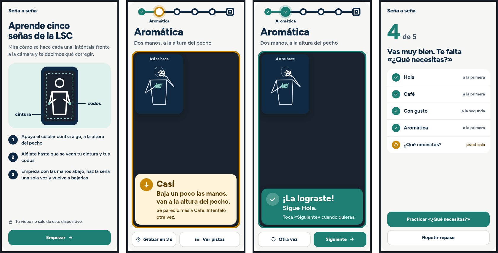

# Seña a seña - práctica con cámara y API

Aplicación para practicar **Café, Aromática, Hola, ¿Qué necesitas? y Con gusto**: cinco lecciones, un repaso sin guía y una indicación concreta cuando un intento falla. Usa el modelo fijado `bundle_iter4_v1`. Reconoce clips aislados; no traduce conversaciones ni sustituye enseñanza de LSC por personas cualificadas. No se ha medido su eficacia educativa.



Pantallas de la interfaz existente, con cámara y respuestas simuladas y guías dibujadas y anonimizadas. Ilustran el recorrido; no son resultados de una prueba real. Permiten inspeccionar la presentación sin depender del servicio.

## Acceso y disponibilidad

El despliegue registrado está en **[sena-a-sena.onrender.com](https://sena-a-sena.onrender.com/)** y requiere contraseña. El acceso a la práctica y a los videos guía se comparte por separado con participantes autorizados; el repositorio no publica la contraseña ni los activos. La comprobación pública más reciente se registra en [resultados §22](../docs/07_results_and_publication_protocol.md#22-presentación-pública-y-comprobaciones-de-la-demo).

Comprobación del 26 de noviembre de 2026 (UTC): la página autenticada y `/api/config` respondieron correctamente; `/api/predict` devolvió HTTP 200 y una respuesta válida para 24 fotogramas de landmarks sintéticos. No se enviaron clips privados ni se midió precisión con esa solicitud. No se comprobó una cámara física remota. La comprobación acredita la respuesta del servicio en ese momento.

## Flujo implementado

1. El navegador captura video y ejecuta MediaPipe Holistic (`0.5.1675471629`).
2. Envía landmarks y tiempos a `POST /api/predict`: 1.662 valores por fotograma; la aplicación no envía el video de cámara.
3. El servidor remuestrea a 24 fps, aplica transformaciones por clip y promedia los tres MLP del modelo fijado.
4. Devuelve la clase, puntuaciones, abstención y, cuando corresponde, una indicación calculada con referencias de train.

**Frontera de privacidad:** el video se procesa en el navegador, pero los landmarks salen del dispositivo. El servidor ejecuta la predicción y la retroalimentación. Esto no equivale a procesamiento completamente local ni a una garantía general de anonimato.

El umbral predeterminado `0.7` permite responder con incertidumbre; no es una probabilidad calibrada de acierto. Los ensayos de una sola persona y los umbrales explorados en esos clips no prueban generalización.

## Código y evidencia

| Pieza | Función |
|---|---|
| [static/app.js](static/app.js) | Captura, MediaPipe, delimitación del intento y envío de landmarks; comprime con gzip si el navegador lo admite. |
| [server.py](server.py) | FastAPI: control de acceso, validación del clip, predicción y respuesta. |
| [predictor.py](predictor.py) | Inferencia con PyTorch. |
| [predictor_np.py](predictor_np.py) | Inferencia con NumPy, sin instalar PyTorch en la imagen de despliegue. |
| [export_numpy.py](export_numpy.py) | Exporta pesos y compara ambos predictores con un conjunto explícito de clips. |
| [coach.py](coach.py) | Una corrección por intento basada en encuadre, manos, altura, contacto o duración. |
| [make_coach_ref.py](make_coach_ref.py) y [make_guides.py](make_guides.py) | Construyen referencias y guías desde train; sus salidas permanecen privadas. |

La comparación reproducida en **90 clips propios de cámara** dio la misma clase en todos y una diferencia máxima de probabilidad de **1,79 × 10⁻⁷** entre PyTorch y NumPy. Es equivalencia numérica sobre esos clips, no exactitud general. Resultados y límites en [07 §22](../docs/07_results_and_publication_protocol.md#22-presentación-pública-y-comprobaciones-de-la-demo).

## Ejecución local con activos autorizados

Ejecuta estos pasos desde la raíz del repositorio. Necesitas Python 3.10; Node no es requisito para servir la aplicación.

1. Prepara el paquete y las dependencias de la API:

   ```bash
   uv venv --python 3.10 .venv
   uv pip install --python .venv/bin/python -r requirements/dev.txt
   uv pip install --python .venv/bin/python --no-deps -e .
   uv pip install --python .venv/bin/python fastapi==0.115.5 uvicorn==0.32.1 huggingface_hub==0.36.0
   ```

2. Obtén el bundle fijado por su canal autorizado y ubícalo en `artifacts/iter3/bundle_iter4_v1/`, o define `LSC5_BUNDLE` con su ruta. Con PyTorch instalado, la API usa `predictor.py` y requiere los `.pt`, normalizadores, `face_perm.npy` y `bundle.json`.

3. Si tienes acceso autorizado al dataset en `data/train/`, genera referencias y guías:

   ```bash
   .venv/bin/python demo/make_guides.py
   .venv/bin/python demo/make_coach_ref.py
   ```

   Alternativamente, usa una copia autorizada de activos preparados: define `LSC5_ASSETS` con una carpeta que contenga `bundle/` y `private/`. Esta última debe contener `coach_ref.json`, `guides.json` y `videos.json`. Si se habilitan videos locales, también se necesita `videos/`. Estos activos, incluidos los esqueletos derivados, no están en Git.

4. Instala MediaPipe para el navegador, una descarga pública sin cuenta:

   ```bash
   mkdir -p demo/static/vendor/holistic
   curl --fail --location https://registry.npmjs.org/@mediapipe/holistic/-/holistic-0.5.1675471629.tgz \
     | tar -xz -C demo/static/vendor/holistic --strip-components=1
   ```

5. Inicia el servidor **solo en localhost**, con guías de esqueleto y sin servir videos del dataset:

   ```bash
   PYTHONPATH=src:demo .venv/bin/python -m uvicorn server:app --host 127.0.0.1 --port 8000
   ```

   Abre `http://localhost:8000`. La cámara requiere localhost o HTTPS. El comando no habilita `LSC5_LOCAL_VIDEOS`. No expongas activos del dataset sin el permiso correspondiente; el despliegue registrado mantiene contraseña.

## API y configuración

`GET /api/config` devuelve clases, umbral y configuración de guías. `POST /api/predict` recibe JSON con `frames` (entre 8 y 240 filas de 1.662 valores), `t` (tiempos en milisegundos, uno por fila) y `target` opcional (`sign_01` a `sign_05`). Devuelve `top`, `confidence`, `abstain`, `tip`, `ranking`, `ms` y `frames`. `ms` mide procesamiento del servidor, no latencia de cámara o red.

| Variable | Uso |
|---|---|
| `LSC5_BUNDLE` | Bundle fijado; por defecto `artifacts/iter3/bundle_iter4_v1/`, o `LSC5_ASSETS/bundle/`. |
| `LSC5_ASSETS` | Activos preparados: `bundle/`, `private/` y, si aplica, `videos/`. |
| `LSC5_PASSWORD` | Si está definida, protege páginas y API. Login y ciertos recursos estáticos quedan accesibles. |
| `LSC5_THRESHOLD` | Umbral de abstención; predeterminado `0.7`, sin calibración demostrada. |
| `LSC5_LOCAL_VIDEOS` | `1` habilita videos guía; requiere autorización y control de acceso apropiado. |

## Exportación NumPy y despliegue

En una **copia local** del bundle, exporta y compara sobre clips propios autorizados; el script añade `*_weights.npz`, por lo que no debe apuntar al paquete de entrega inmutable:

```bash
PYTHONPATH=src:demo .venv/bin/python demo/export_numpy.py /ruta/a/copia-del-bundle '/ruta/a/clips-propios/*.npy'
```

El [Dockerfile](Dockerfile) usa NumPy, FastAPI y Uvicorn, descarga la versión fijada de MediaPipe y obtiene activos privados con [fetch_assets.py](fetch_assets.py). No instala PyTorch. Requiere `HF_TOKEN` de lectura y `LSC5_ASSETS_REPO` configurados fuera de Git; el arranque depende de tener acceso al repositorio privado. Secretos y permiso de uso de activos no vienen incluidos en el código.

No hay una prueba automatizada de navegador y cámara incluida en la suite del paquete. Los ensayos propios y la paridad numérica se documentan por separado de las pruebas del modelo.
