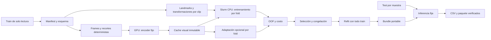

# 05 · Arquitectura técnica propuesta · revisión R2.1

Diseño del 19 de noviembre de 2026. El [protocolo R2.1](04_solution_and_experiment_design.md) posee recetas, selección y límites de ajustes; [06](06_delivery_and_iteration_plan.md) posee presupuesto monetario, ejecución y calendario. Este documento posee contratos e interfaces. Los incrementos CPU implementan el piloto y la línea base LOSO R0/MLP; la arquitectura restante conserva su alcance de diseño. Autorización y evidencia en00/ítem OpenSpec.

## 1. Decisiones y límites

Se construirá un paquete Python offline, con CLI y lanzadores delgados para Slurm o una GPU externa. El trabajo se divide en extracción visual fija, aprendizaje CPU y adaptación visual opcional. Código, datos y resultados permanecen desacoplados por rutas y manifests; ningún servicio remoto es requisito para cargar el modelo final.

| ADR propuesto | Decisión y alternativa | Razón / prueba requerida |
|---|---|---|
| ADR-01 | Un paquete y CLI; notebooks opcionales como lanzadores. | Evitar implementaciones distintas por entorno; reproducir un recorrido pequeño en dos procesos. |
| ADR-02 | Registro y artefactos locales; sin plataforma de tracking externa. | Volumen pequeño y plazo corto; reconstruir el resumen desde runs y conservar todos los intentos. |
| ADR-03 | Contratos comunes, perfiles separados para landmarks, embeddings y tokens. | No fingir que un caché RGB es un NPY de pose; validar shapes y productor de cada perfil. |
| ADR-04 | Encoder visual externo congelado compartido; estados aprendidos fold-local. | Amortizar extracción sin aprender del sujeto retenido; pruebas negativas de carga entre folds. |
| ADR-05 | Python 3.10 compatible con Cronos, lock CPU y lock GPU diferenciados. | Reutilizar el entorno observado; verificar portabilidad de checkpoints. La propuesta anterior de 3.11 se sustituye. |
| ADR-06 | Fragmentos inmutables y publicación atómica de cachés. | Una interrupción no exige repetir imágenes ya extraídas; un resultado parcial no aparenta cobertura completa. |
| ADR-07 | Presupuesto por corrida y por proyecto, fuera del modelo. | Una métrica no habilita recargas ni supera el límite de caja; reservas y permisos se comprueban antes de lanzar. |
| ADR-08 | Bundle final independiente de proveedor y del caché train. | Ejecutar con video/landmarks de una muestra y pesos propios; ensayar CPU/local antes de congelar. |

Estas son decisiones de arquitectura propuestas. No se añade UI, API, despliegue público ni entrenamiento distribuido. Los entregables de competición y el aislamiento del test se heredan de [01](01_problem_definition.md).

## 2. Flujo y responsabilidades



| Componente | Responsabilidad / frontera |
|---|---|
| `data.manifest`, `data.schema`, `data.splits` | Inventario train, layout acreditado, IDs/roles y hashes. El loader de test solo se habilita en inferencia final. |
| `features.pose`, `features.video` | Geometría, máscaras, muestreo de frames y ROI; funciones deterministas por clip. |
| `features.cache` | Escribir, validar y consultar cachés fijos o derivados con procedencia y cobertura explícitas. |
| `models`, `training` | Adaptadores y aprendizaje solo con IDs permitidos; checkpoint y restauración. |
| `evaluation`, `selection` | OOF y costo completo, reglas de promoción y manifiesto congelado. |
| `execution` | Presupuesto, locks, launcher local/Slurm/GPU; no decide hiperparámetros a partir de fallos. |
| `inference`, `submission` | Bundle completo, predicción independiente y cobertura exacta del CSV. |

La estructura propuesta conserva `pyproject.toml`, `configs/`, `src/lsc5/`, `tests/`, `notebooks/` opcional y `artifacts/` privado. Las raíces se resuelven con argumentos o `LSC5_DATA_ROOT` y `LSC5_ARTIFACT_ROOT`. Los datos originales, pesos, cachés, credenciales y copias de artículos quedan fuera de Git. La licencia propia se decide antes de publicar.

## 3. Contratos de datos y roles

`TrainManifest` por muestra: ID, etiqueta/código, persona, vista/cámara como metadatos de auditoría, rutas relativas de modalidades, T, dtype, hashes de archivos y `landmark_content_group_id`. `execution_group_id` puede ser nulo con `execution_group_status=unknown`. Hash de landmarks idéntico no acredita identidad de video ni de ejecución física.

IDs, nombres, cámara y vista nunca entran al modelo. La auditoría comprobó asociación cámara–clase; ese dato limita la interpretación y no justifica usarlo como predictor. Los duplicados exactos dentro de sujeto se conservan; el split por persona los mantiene juntos. Una coincidencia de contenido inesperada entre roles detiene la corrida para revisión.

`SplitSpec`: `protocol_revision`, `fit_role`, `outer_signer`, listas de `train_ids` y `validation_ids`, hashes y `parent_run_ids`. En R2 los roles activos son `outer` y `final`; no existe ajuste interno ni pretraining local presupuestado. El esquema admite futuras extensiones explícitas, sin reusar nombres antiguos con otro significado.

El manifest de test contiene únicamente IDs/rutas que exige la plantilla, sin etiquetas. No se abre para generar estadísticas ni cachés exploratorios. Su lectura de payload se habilita con `fit_role=inference`, `selection.json` congelado y bundle completo.

`RawSequence`: valores float64 `(T,1662)`, finitud/forma comprobadas, sin pickle ni reinterpretación anatómica implícita. Convertir a float32 en el límite de features. Decodificador y landmarks deben conservar la correspondencia de fotogramas cuando se usan juntos.

## 4. Contratos de features y modelos

| Perfil | Contenido y shape | Invariantes |
|---|---|---|
| `PreparedPoseBatch` | `values float32[B,T,F]`, `time_mask bool[B,T]`, `observation_mask bool[B,T,49]`, `time_index float32[B,T]`, longitudes | Dimensiones R1/R2/R3 y orden exacto en 04. Padding y observación son conceptos diferentes. |
| `PreparedStatsBatch` | `values float32[B,1,3324]`, máscara temporal verdadera | Preprocesador R0 con ajuste fold-local; columnas opacas. |
| `FrozenVisualBatch` | `features float32[B,K,384]`, índices de frames, `time_mask`, `cache_key` | Encoder externo y transformaciones fijos; sin actualización de estado. |
| `VisualPixelsBatch` | RGB uint8 o float32 normalizado, `[B,K,3,224,224]`, versión de transform y crop | No mezclar normalización dos veces; canal RGB acreditado con prueba. |
| `PrefixTokenBatch` | `tokens float32[B,K,257,384]` | Solo encoder estándar sin registros y punto de corte pactado; no son tokens normalizados de salida. |

Todos llevan `sample_ids` como metadatos y etiquetas únicamente en ajuste/evaluación permitidos. `quality_flags` permanece fuera de `values`. Validez local de manos y máscaras de diferencias que 04 define como canales sí son features explícitas y versionadas.

`imputed_mask` puede existir por compatibilidad futura, pero es completamente falsa en R2: **R3 ahora identifica diferencias, no interpolación**. Una receta de reconstrucción posterior requiere otro `feature_schema_id`. La arquitectura no hereda los canales F196 del diseño previo.

La normalización geométrica utiliza exclusivamente el propio clip y la política de 04. Primero convertir XY acreditados a fracciones de imagen, mediante x/W e y/H si la fuente está en píxeles; preservar XY originales y dimensiones para ROI. Umbrales y respaldos geométricos usan las unidades canónicas de 04. Ausencia de anclas con otra señal admite respaldo fijo; ausencia total invalida el perfil de landmarks. El extractor ROI lee observaciones acreditadas sin exigir previamente la normalización de R1: si faltan puntos suficientes puede usar la vista global según 04. Corrupción de formato o coordenadas sin significado acreditado no se oculta como fallback válido.

`Preprocessor.fit(ids)` registra `fit_ids_hash`, algoritmo y estadísticas; `transform(sample,state)` no modifica estado ni consulta otras muestras. Scalers de R0 y embeddings se ajustan solo con IDs del fold; finalfit los reajusta con todo train. Pose determinista, valores de ImageNet y prefijo externo fijo no requieren un fit de dataset.

`Model.forward(batch)` devuelve logits float32 `[B,5]`, finitos, orden `sign_01`…`sign_05`. Inferencia con `eval()`, sin dropout activo ni BatchNorm mutable. Pooling, atención y convolución excluyen padding en todos sus límites de mezcla. En entrenamiento GPU se permite acumulación de gradientes para conservar el batch efectivo, sin introducir normalizaciones dependientes del microbatch.

## 5. Cachés: contrato productor–consumidor

Un caché externo fijo contiene exclusivamente una función por clip de pesos externos congelados. Está permitido compartirlo entre folds train. Un caché que incluye normalización aprendida, PCA, adaptador o encoder ajustado se considera derivado de un fit y exige `fit_ids_hash`, rol y checkpoint de ese fit. No puede presentarse como universal.

`CacheSpec` debe incluir:

- `cache_schema_version`, `protocol_revision`, `feature_schema_id`, `cache_kind` (`cls` o `prefix_tokens`) y `scope=train|final_inference`.
- Fuente/commit, URL y SHA256 del peso, arquitectura exacta, capa de extracción, estado `eval`, dtype de cálculo y almacenamiento, normalización.
- Decoder/versiones, manejo de orientación, política de N/frames, K, crop/padding, orden de canales y resolución.
- Huella del manifest, IDs ordenados, hashes de cada video y de landmarks si el crop depende de ellos, índices de frames y caja usada por clip.
- Dependencias aprendidas, normalmente vacías en caché externo; hash/roles cuando no lo estén.
- Shapes, integridad de fragmentos, estado de cobertura y errores explícitos por muestra.

Los frames preparados tienen su propio contrato e integridad, además de los embeddings finales. Se proponen paquetes por 32 clips, RGB uint8 y compresión sin pérdida. El tamaño comprimido se mide; no se usa una razón estimada para autorizar el gasto. No empaquetar etiquetas, credenciales ni rutas personales como entradas del encoder; los IDs de enlace no son features.

Cada fragmento tiene un solo escritor, archivo temporal, hash y renombre atómico. Reanudar verifica pesos/config/inputs y omite únicamente clips completos coincidentes. Un proceso finalizador publica `complete=true` después de comprobar todos los IDs esperados, sin duplicados ni faltantes. El consumidor rechaza fragmentos parciales, pesos o crops distintos y orden de IDs no verificable. Extraer el mismo clip dos veces debe producir embeddings equivalentes dentro de la tolerancia fijada por entorno; el desempate de fragmentos nunca elige según accuracy.

Guardar `cache_metadata.json`, `index.jsonl` y shards de arrays no ejecutables, con `allow_pickle=False`. Evitar compresión que requiera cargar todo el proyecto en RAM. El token cache opcional se consume por clip/shard; su tamaño y traslado cuentan como costo. No se extrae por defecto para todas las vistas.

La activación de prefijo para E11 se toma después del bloque índice 10 en el ViT de 12 bloques, antes del adaptador y del bloque 11. Se conservan los 257 tokens, incluido CLS, tras el procesamiento de posición del prefijo. El replay aplica adaptador, bloque 11 y normalización final del mismo checkpoint. Prefijo y bloque congelados permanecen en evaluación; el bloque final admite gradiente hacia el adaptador. La posición de hook y una prueba de equivalencia son contrato de aceptación, no una suposición sobre nombres de una API.

El bundle puede calcular desde píxeles el mismo prefijo en CPU/GPU cuando no existe caché. El token cache de train no es un requisito de inferencia ni se distribuye como sustituto de los pesos.

## 6. Configuración, artefactos y reanudación

Toda corrida guarda JSON resuelto sin expresiones ejecutables. Claves necesarias: `protocol_revision`, `experiment_id`, `variant_id`, `seed`, huellas de datos/features/cache/split, rol/persona, `parent_run_ids`, modelo, preprocesamiento, optimización, política de épocas y `budget`. Las rutas y hardware se conservan como procedencia, fuera de la identidad semántica de una receta.

`budget` enlaza un registro privado del proyecto y declara máximos de tiempo, memoria, moneda, costo estimado comprometido y reserva. El runner no contiene credenciales de pago ni recarga automática. Un proveedor se usa solo después de resolver cuenta/mecanismo/autorización; el límite de diseño no es una autorización de compra.

| Artefacto privado por corrida | Contenido y uso |
|---|---|
| `resolved_config.json`, `environment.json` | Receta completa, dependencias y dispositivos reales. |
| `split.json`, `preprocessor_state.*` | Roles, IDs permitidos, hashes y estado aprendido. |
| `events.jsonl`, `metrics.json` | Inicio/fin, intentos, finitud, costos, métricas y estado de finalización. |
| `checkpoint_last.pt` | Modelo/optimizador/scheduler, epoch, sampler/cursor y RNG. Cargar solo checkpoints propios o confiables. |
| `oof_predictions.*` | ID, etiqueta train, logits/probabilidades y fold/semilla; sin datos privados de test. |
| `result.json` | Receta fija completada o intento fallido, costo y motivo. |

Para reanudar, semillas derivadas de corrida/época/ID/transform; guardar orden del muestreador. Reanudar a mitad de época solo si se implementa y verifica cursor/RNG; de otro modo recuperar último límite de época y contabilizar el trabajo repetido. No prometer igualdad bit a bit entre CPU/GPU o bibliotecas distintas.

Si cambia batch efectivo, esquema, resolución, cantidad de frames, encoder, loss o normalización, crear variante nueva. OOM/timeout no selecciona un checkpoint alternativo ni abre test para diagnóstico. Los fallos gastan presupuesto y permanecen visibles.

### Perfil de caché R0 del primer incremento

`raw_stats` es un perfil determinista distinto de `cls|prefix_tokens`: `[N,3324]` float32, IDs ordenados y esquema `raw_stats_v2`. Su contrato de productor/consumidor está en el [diseño del ítem CPU](../openspec/changes/archive/2026-11-19-cpu-pilot-walking-path/design.md): cobertura completa, huellas de entradas/productor/NPZ y publicación atómica. El escalador fold-local no forma parte de este caché. La predicción restaurada también debe reconstruir R0 desde originales, sin depender de él.

## 7. Ejecución entre entornos y operación

Cronos mantiene `~/Dataset` de solo lectura para los originales, código propuesto en `~/LatamIAChallenge` y artefactos en `~/resultados/<run_id>`. El inventario canónico 08 posee recursos/límites; no se presupone permanencia hasta el 25. Un entrenamiento se envía con Slurm, nunca se ejecuta en la sesión SSH limitada.

Por ajuste CPU se propone 4 CPU,8 GiB de RAM iniciales y duración solicitada 75 minutos; ampliar memoria hasta el máximo permitido solo si el piloto lo justifica. PyTorch intra-op 4/inter-op 1, BLAS como máximo 4, loader 0 y un único fit por job; evitar paralelismo anidado. Los jobs no usan GPU de Cronos. Máximo dos activos y dos pendientes, con checkpoint periódico y logs privados.

GPU externa: una sola instancia/función y una GPU, procesamiento por clip o lote pequeño, máximo de concurrencia 1 y reintentos automáticos desactivados para operaciones cobradas. Preparar dependencias y peso antes del período facturado cuando el proveedor lo permita; si no, medir y presupuestar esa preparación. El encoder trabaja en `no_grad` excepto el bloque necesario para E11.

Los artefactos se copian con hash al terminar cada unidad útil. Un crédito gratuito o instancia parada no demuestra almacenamiento sin cargo. Borrado de recursos y cierre de facturación requieren verificación del proveedor, después de recuperar lo necesario. Los datos/cachés permanecen privados y cualquier transferencia debe estar dentro de las condiciones del reto y del servicio aprobado.

CPU/local es una ruta real de entrenamiento compacto e inferencia de respaldo. Colab es opcional por integrante y límites propios, sin rotación de identidades ni workers distribuidos. Los locks y entornos CPU/GPU son distintos cuando cambian builds, con versión de modelo común y chequeo de carga cruzada.

## 8. Selección, bundle e inferencia final

`selection.json` registra reglas aprobadas, variantes elegibles e intentos, conjunto de semillas común, métricas OOF, costos y receta/pareja elegida. Incluye referencias a hipótesis y decisiones de cada ola, sin duplicar métricas o presupuesto. `freeze.json` fija código, configs, pesos externos, transformaciones, clases, combinación y hashes antes de leer payloads test. La mezcla es la definida en 04; el software no aprende pesos del ensemble.

El bundle contiene pesos finales propios, scaler final, contrato anatómico si aplica, encoder externo o referencia verificable restaurable, índices/crop/normalización y clases. Si usa ROI, se declara que el preprocesamiento también necesita landmarks; no se presenta como inferencia RGB independiente de pose. Si usa adaptador, incluye todo el encoder necesario para reconstruir su prefijo.

Finalfit usa los 1.125 clips y semillas/épocas de selección. Ningún scaler externo de un fold se conserva por conveniencia. Los caches externos fijos train siguen válidos; los adaptadores se reinicializan y ajustan con todo train.

Antes de congelar, probar la predicción completa de muestras train en CPU/local, en otro proceso, sin el caché de entrenamiento; medir tiempo y memoria. Durante inferencia test se procesa cada muestra por reglas fijas, sin PCA, calibración, pseudoetiquetas, balances globales ni actualización del encoder. Un error de contenido interrumpe la entrega para diagnóstico técnico; no inventa una etiqueta ni omite un ID.

El CSV cumple dos columnas exactas `video_id,predicted_sign`, plantilla como cobertura, códigos válidos, UTF-8/comas, ninguna fila extra/faltante/duplicada, sin índice adicional y hash final. Se empaquetan pesos, código, reporte y evidencia de ejecución según el canal organizativo.

La precisión R2.1 añade al manifiesto congelado la política de 04 §12: dos oportunidades, cuenta la última, segunda reservada para recuperación técnica. Guardar CSV/versiones inmutables y entradas de envío/acuse en `events.jsonl`, con hashes y vínculo al bundle; no sobrescribir un archivo ya enviado. Si se corrige un defecto técnico permitido, registrar evidencia independiente del score, validación local y vínculo `supersedes` de la versión corregida. No automatizar el uso del segundo intento ni elegir otra receta según respuesta de la página. El reporte y los pesos finales deben concordar con el CSV oficialmente vigente.

## 9. Interfaces disponibles y propuestas

El primer incremento implementa `data.py` para manifest/splits, `features.py` para R0/caché/scaler, `models.py`, `training.py`, `budget.py`, `restore.py` y `cli.py` en `src/lsc5/`. Los perfiles cerrados de dos y80 épocas comparten receta fijada en código y serializada resuelta en `run.json`; no hay un archivo de configuración editable que altere silenciosamente el protocolo. Configuración general y perfiles temporales/visuales quedan para los ítems posteriores.

Comandos disponibles, ejecutados desde la raíz con el entorno CPU instalado:

```bash
lsc5 audit-train --data-root data --out artifacts/cpu-pilot/train_manifest.json
lsc5 make-splits --manifest artifacts/cpu-pilot/train_manifest.json --out artifacts/cpu-pilot/splits
lsc5 prepare-stats --data-root data --manifest artifacts/cpu-pilot/train_manifest.json --out artifacts/cpu-pilot/raw_stats
lsc5 --help
```

El incremento de línea base añade `fit-baseline` con los mismos argumentos de `pilot`, pero perfil cerrado de80 épocas/semilla17 y cohorte completa1125. `predict-train` restaura ambos perfiles, verificando identidad de receta e hiperparámetros. `aggregate-oof --manifest ... --runs <M02> <M03> <M04> --out ...` admite únicamente tres folds completos compatibles; conserva logits/probabilidades, comprueba verdad train, cobertura, distribuciones y publica atómicamente el reporte. Contratos específicos en el [ítem de línea base](../openspec/changes/archive/2026-11-19-cpu-baseline-loso/design.md).

`budget-enable-baseline --budget ...` agrega idempotentemente el alcance aprobado de3600s al ledger existente; `budget-reserve --scope cpu-baseline-loso` reserva allí cada intento. No reinicializa consumos. `scripts/cronos_baseline.sbatch` usa4CPU/8GiB/10min, con el mismo procedimiento de reserva900s, job retenido, vínculo y liberación. Máximo dos trabajos simultáneos. El claim verifica también que el perfil coincide con el alcance presupuestario.

La CLI también ofrece `budget-init/reserve/bind/settle`, `pilot` y `predict-train`, con argumentos en su `--help`. El piloto exige reserva previa vinculada a Slurm; el lanzador es `scripts/cronos_pilot.sbatch`. Presentar el job retenido, vincular su ID en el ledger y liberar solo ese job. Reservar900s tras verificar que cubren TimeLimit600s+KillWait; después de estado terminal, liquidar con ElapsedRaw del job, una sola vez. No ejecutar estos pasos para reservar/entrenar de nuevo sin un ítem autorizado. La predicción restaurada usa `--data-root`, `--manifest`, `--run` y `--out` y reconstruye R0 desde NPY train originales.

Implementado el20nov (`delivery.py`): `delivery-loso --seed {17,29,43}`, `finalfit-baseline --seeds ...` y `validate-submission`. `predict_bundle`/`write_submission` existen como funciones de biblioteca y rechazan rutas test, salvo una habilitación explícita futura. El bundle es `r0_mlp_bundle_v1`: pesos `state_dict`, escaladores `.npz`, `bundle.json` con hashes y promedio de probabilidades. Evidencia en07 §13.

Las interfaces siguientes son **propuestas para incrementos posteriores**; no son comandos disponibles en este incremento:

```text
lsc5 audit-train --data-root <root>
lsc5 verify-schema --manifest <train-manifest> --schema <schema>
lsc5 make-splits --protocol R2 --manifest <train-manifest>
lsc5 prepare-frames --manifest <train-manifest> --spec <rgb-spec>
lsc5 extract-features --frames <manifest> --encoder <pinned-spec> --resume
lsc5 validate-cache --cache <root> --manifest <manifest>
lsc5 run --config <resolved.json> [--resume <run-id>]
lsc5 select --spec <approved.json> --evidence-root <root>
lsc5 finalfit --selection <selection.json>
lsc5 predict --bundle <bundle> --template <template.csv> --output <csv>
lsc5 validate-submission --template <template.csv> --submission <csv>
```

No son comandos instalados actualmente. Las pruebas del primer ítem deben cubrir:

- Esquema, dtype, finitud, lectura sin pickle, lateralidad/unidades acreditadas y caso de frame real cero.
- Exclusión de persona/test y rechazo de estado aprendido de otro fold; etiquetas y mapeo estables entre entrenamiento/carga.
- Máscaras, padding adicional, cambio de batch/orden sin alterar una predicción individual.
- Caché íntegro, shards interrumpidos, mezcla de pesos/crops rechazada y reanudación sin repetir clips completos.
- Replay de prefijo y dimensiones exactas antes de admitir E11; bloqueo si no hay presupuesto comprometido suficiente.
- Recorrido pequeño train→OOF→bundle→inferencia desde originales en un nuevo proceso; CPU/local antes de seleccionar RGB.
- Restauración de checkpoint, corte por tiempo/presupuesto y cobertura exacta del CSV sobre una plantilla sintética derivada de train.

Las pruebas usan fixtures sintéticos o train autorizado. Una prueba estática no demuestra velocidad, costo real o accuracy; cada uno conserva evidencia independiente. No se utiliza test para validar competitividad.

## 10. Integración y revisión

El origen de la semántica y la selección está en 01/04; el contrato de transporte y artefactos se define aquí; caja, proveedores y calendario en 06; reporte/publicación en 07. La documentación debe señalar cualquier desviación que cambie la comparación.

Quedan por validar el esquema anatómico, decoder remoto, rendimiento de recetas completas/visuales, compatibilidad de peso/API y condiciones de la cuenta externa. El piloto R0 solo mide este perfil y entorno; su evidencia pertenece al ítem, sin extrapolar accuracy o throughput a otras arquitecturas. La autorización SSH de Cronos está concedida; no se extiende por sí sola a otro proveedor. Cada incremento conserva revisión de fundación/propuesta y verificación conforme a su alcance.


## 12. Verificación de procedencia anatómica · 19 nov2026

El siguiente incremento fue autorizado para verificar el contrato y habilitar E02 solo si se acredita R1. Resultado inicial: **contrato todavía no acreditado**. El manual §3 enumera pose132/rostro1404/manos63+63, pero introduce la forma con «Si el archivo sigue esta disposición». La auditoría02 ya establece que no se validó el extractor y que bloques cero observados no prueban ausencia de detección. No se encontró su implementación en el código disponible.

La [documentación primaria de MediaPipe Holistic](https://chuoling.github.io/mediapipe/solutions/holistic.html#output), consultada el19 nov2026, describe salidas separadas de pose, rostro y manos; XY de imagen normalizadas y una salida alternativa de pose mundial en metros. Eso respalda convenciones de la biblioteca, pero no demuestra cuál se guardó, su concatenación, transformación previa o relleno de ausencias en estos NPY. Tampoco fija la versión concreta del extractor del reto.

Pendiente: código o especificación del productor que determine orden/intercalado, lateralidad y posibles espejados, unidades, salidas elegidas y política para detecciones faltantes. Contrastar después con train y correspondencia visual; no inferir que una hipótesis es cierta porque produce figuras o accuracy plausibles. El usuario confirmó que solo se dispone del manual y los datos; considera posible solicitar detalles, sin plazo acreditado. No se contactó a organizadores. R1/ROI y TCN anatómica siguen condicionadas; R0 permanece válida. No se entrenaron modelos nuevos en esta comprobación inicial.


## 13. Contrato de continuidad temporal opaca · R2.2

R2.2/04 §13 fue aprobada por el usuario. La implementación añade un perfil independiente `opaque_sequence_v1`, sin modificar `raw_stats_v2` ni modelos previos. Caché determinista por clip con T original y1662 columnas; sin escalado global. Producer/schema/hash/IDs y publicación atómica siguen los contratos existentes. El nuevo estado aprendido por fold registra1662 medias/desviaciones, definición de ponderación por frame y hashes de fit IDs. La transformación se reproduce desde NPY originales; no depende del caché.

Batch implementado `[B,Tmax,1662]`float32 con máscara temporal `[B,Tmax]`. Tests deben acreditar invariancia de logits al añadir padding, equivalencia de un clip solo/en batch con longitudes distintas, separación de frame real cero/padding y pesos/estadísticas invariantes ante cambios exclusivos en retenidos. El escalado ignora padding, no los ceros reales. Bloque residual y enmascarado se fijan en04; no introducir máscaras anatómicas por conveniencia.

Motor/artefactos/OOF deben admitir una identidad nueva sin volver elegibles los diagnósticos. Conservar receta completa, hashes, escalador, logits y restauraciones. La comparación pareada alinea IDs/verdad con R2-E01, preservando ambos snapshots; productor nuevo no permite reinterpretar un run viejo. Presupuesto añade un alcance específico idempotente al ledger activo, conservando sus21s previos y reserva final; valor efectivo se verifica remotamente antes de admisión. La CLI implementa `fit-temporal`, `temporal-enable`, `temporal-reserve`, `temporal-admit` y `compare-oof`; `predict-train` y `aggregate-oof` discriminan las recetas. La admisión exige `--restoration-receipt`, generado por restauración desde originales, junto con su NPZ hasheado. La comparación exige `--baseline-report-sha256`, tomado de la referencia congelada antes de correr E02O. El gate conserva ambos hashes de restauración; el productor del candidato es actual y el de la baseline conserva su snapshot histórico. Las pruebas y la medición real se acreditan en el ítem, no por esta descripción.


Recorrido temporal disponible: habilitar alcance con `temporal-enable`; reservar piloto con `temporal-reserve --pilot`, vincular job y ejecutar `scripts/cronos_temporal_pilot.sbatch` con `fit-temporal --pilot`. Únicamente el piloto puede preparar caché desde `--train-zip` explícito llamado `Train.zip`; lee solo los NPY train esperados y coteja sus hashes. Tras contabilidad Slurm terminal, `predict-train` devuelve JSON de restauración y escribe el NPZ; conservar ambos juntos. `temporal-admit --budget … --manifest … --run … --restoration-receipt …` verifica su integridad antes de habilitar reservas completas. Cada fold usa `scripts/cronos_temporal_full.sbatch`, su split externo y `fit-temporal` sin `--pilot`. `aggregate-oof` exige los tres folds; `compare-oof --manifest … --candidate … --baseline … --out … --baseline-report-sha256 …` compara contra el reporte congelado. Los puntos suspensivos son argumentos a resolver, no un comando listo para pegar. `python -m lsc5.cli <comando> --help` enumera los parámetros efectivos.


## 14. Contrato e implementación del piloto RGB local

Implementación aprobada y disponible,20 nov2026. Entorno aislado `.venv-rgb`, sin modificar `.venv`, locks CPU ni snapshots previos. Python3.10.12, PyTorch2.4.1+cu121/torchvision0.19.1+cu121, NumPy1.26.4 y Pillow11.3.0; la [tabla oficial de versiones PyTorch](https://pytorch.org/get-started/previous-versions/) confirma esa pareja, consultada20 nov2026. Instalar/validar desde el índice oficial, registrar resolución exacta y probar CUDA en vez de inferirla del controlador. No requiere xFormers; deshabilitarlo y usar atención PyTorch, float32, sin AMP/TF32, modelo congelado en `eval()`/`inference_mode()`.

Fuente DINOv2 fijada al commit `7764ea0f912e53c92e82eb78a2a1631e92725fc8` del [repositorio oficial](https://github.com/facebookresearch/dinov2/tree/7764ea0f912e53c92e82eb78a2a1631e92725fc8); [model card](https://github.com/facebookresearch/dinov2/blob/7764ea0f912e53c92e82eb78a2a1631e92725fc8/MODEL_CARD.md) declara Apache2.0 para los modelos, concordante con [licencia](https://github.com/facebookresearch/dinov2/blob/7764ea0f912e53c92e82eb78a2a1631e92725fc8/LICENSE). Comprobados20 nov2026. El [peso oficial ViT-S/14](https://dl.fbaipublicfiles.com/dinov2/dinov2_vits14/dinov2_vits14_pretrain.pth) fue descargado:88283115bytes, SHA256 `b938bf1bc15cd2ec0feacfe3a1bb553fe8ea9ca46a7e1d8d00217f29aef60cd9`. El inventario íntegro de la fuente tiene digest `c2c37d49b24e354c91695086887ae7222439e482e8256d221dc0be40ea903ee8`; se verifica antes de importar. No confundir accesibilidad HTTP, licencia y compatibilidad medida.

Construir solo el backbone estándar desde la fuente fijada con `pretrained=False`; cargar el peso local con `weights_only=True` y coincidencia estricta del state dict. Registrar SHA256 del archivo binario y archivo/fuente usados antes del primer forward. No ejecutar instalación o hub de una rama mutable. Fuente/pesos/entorno quedan fuera de publicación; el código propio conserva atribución y las condiciones de redistribución de terceros se revisan antes de publicar.

El manifiesto y30 IDs preseleccionados pertenecen exclusivamente a train, como en04 §14. Comprobar cada hash de video antes de decodificar. FFmpeg/ffprobe versión registrada, un hilo; conteo mediante decodificación. Leer secuencialmente RGB24, sin descartar/duplicar frames por FPS; rechazar rotación no cero en este piloto en vez de asumir orientación. No cargar el video completo en RAM: procesar un frame original por vez, retener solo seleccionados redimensionados. Usar N real, índices `floor(j*(N-1)/15+0.5)`, Pillow bilinear, dimensión larga224, corta `max(1,floor(dim_corta*224/dim_larga+0.5))`; pegar centrado con offset entero inferior sobre canvas224. Relleno uint8 `(124,116,104)`, redondeo declarado de255×media ImageNet; escalar a[0,1] y normalizar por media `(0.485,0.456,0.406)`/desviación `(0.229,0.224,0.225)`. La cuantización del relleno no es exactamente cero tras normalizar; queda fijada, sin suponer equivalencia al center crop de entrenamiento original.

Microbatch fijo4 frames para el piloto, sin alterar K ni precisión para remediar un fallo. Salida por clip `(16,384)` float32 y metadatos del contrato de caché §5, `scope=train`, `coverage=pilot30`; no marcarla completa para1125 ni permitir que una cabeza completa la acepte. Un escritor, temporales+hash+rename y arrays sin pickle. Repetir un clip en proceso nuevo desde video/peso originales; comparar batch1 frente a4 con error relativo L2≤1e-4 y finitud, registrando además máximo error absoluto. Estos dos tamaños son verificación de inferencia, no búsqueda por score. El piloto no reanuda ni repite intentos. Cualquier futuro mecanismo de reanudación deberá omitir únicamente clips íntegros con la misma identidad. No producir ni compartir tokens de prefijo.

Implementados `rgb_frames`, `rgb_encoder`, `rgb_pilot`, `rgb_supervisor` y `rgb_budget`. El supervisor vigila RAM/RSS cada100ms mientras consulta GPU asíncronamente; limpia únicamente sus grupos de procesos ante señal/fallo/plazo. Reserva y claim se realizan en el ledger único remoto; el claim liga máquina/directorio, con bloqueo local canónico y marcador de lanzamiento de un uso, sin abrir un segundo registro de presupuesto. El worker exige supervisor. Los productores anteriores mantienen snapshots separados; no reinterpretar sus artefactos como producidos por código nuevo. AC: [propuesta del piloto](../openspec/changes/archive/2026-11-20-rgb-global-pilot/proposal.md).

Resolución exacta en `requirements/rgb.lock`, desde el índice oficial CUDA12.1. Preparación reproducible del entorno separado: `uv venv --python 3.10 .venv-rgb` y `uv pip sync --python .venv-rgb/bin/python requirements/rgb.lock --index https://download.pytorch.org/whl/cu121 --index-strategy unsafe-best-match`. Fuente/peso privados verificados no se descargan automáticamente al ejecutar. Usar `PYTHONPATH=src` desde la raíz; `python -m lsc5.cli <comando> --help` muestra los argumentos completos.

| CLI implementada | Alcance |
|---|---|
| `rgb-budget-reserve` / `rgb-budget-claim` | Un intento660s en ledger existente; claim atómico ligado a máquina y directorio. Ejecutar con el productor fijado en el host del ledger. |
| `rgb-supervise` | Única entrada de ejecución local: preflight, piloto30 y replay en procesos separados, límites y recibo terminal. Usar `.venv-rgb/bin/python`. |
| `rgb-pilot` / `rgb-replay` | Workers internos del supervisor; no lanzarlos directamente. |
| `rgb-budget-settle` | Liquidar exactamente una vez el recibo terminal, incluyendo fallos y consumo real. |

Estos comandos no extraen1125, entrenan cabezas ni infieren test. Evidencia operativa y decisión en07 §10; reserva/consumo en06 §11.


## 15. Reserva explícita para un único reintento

La solicitud directa del20 nov permite `rgb-budget-reserve --retry-of <ID_original>` una sola vez bajo el perfil `rgb-global-pilot-retry`. Exige original fallido y liquidado, selección/manifiesto idénticos y liga su recibo; claim vuelve a verificar el padre. Sin indicador sigue vigente el único intento original. No permite usar como padre el propio reintento ni un original completado. Nuevo productor/snapshot y salida; pipeline y dependencias conservan los hashes originales. Este control de presupuesto no concede por sí mismo autorización humana para usarlo: en este ítem existe la solicitud explícita registrada en00.


## 16. E07/E08 · caché completo y cabeza

El caché externo `full1125` contiene1125×16×384float32 y registros ordenados por manifest train; un consumidor de cabeza exige esa cobertura, hash y fuente, nunca `pilot30`. Se mantiene la identidad científica deR4. Se propone filtrar índices únicos con FFmpeg antes de transportar RGB24, conservando conteoN, decodificación íntegra, índices repetidos y letterboxPillow. La [documentación oficial de select](https://ffmpeg.org/ffmpeg-filters.html#select_002c-aselect), consultada20nov2026, define `n` desde0; compatibilidad efectiva4.4.2 y equivalencia se verifican localmente con casos sintéticos y SHA de píxeles30históricos. Si falla, conservar decoder anterior.

`rgb_pyramid_mlp_v2`:384 medias/desviaciones ddof0 calculadas sobre todos los16frames de750fit, acumulaciónfloat64/estadofloat32, escala<1e-6→1 y fitIDs750. Escalar antes de medias global/primera8/última8; concatenación1152→128ReLU/dropout.3→5. Validación solo transforma. Sampler/LR/80épocas/17 según04, sin selección intermedia. Control inverso diagnóstico cambia únicamente orden temporal en validación.

CPU4CPU/8GiB enCronos; piloto M02dosépocas y probe60fit-only descartado. Restore del piloto en procesoCPU nuevo usando caché inmutable; sus resultados no entran enOOF. Tras gate medido y tresfits, procesoGPU nuevo decodifica1125originales y restaura375probabilidades por cada modelo externo, atol1e-6/rtol0. El predictordesdeoriginales no requiere caché de entrenamiento; puede conservar arrays reextraídos como evidencia. Nunca entrenar sobre ellos para este ítem. El productor se congela antes de ejecutar y conserva snapshot; no se cambian fuentes durante extracción o ajuste. Las interfaces implementadas se describen a continuación; la evidencia de ejecución pertenece a07.

Implementación E07/E08: `rgb-loso-enable/reserve/admit` gestiona alcance/gate; `rgb-full-claim/settle` conserva perfiles locales, `rgb-full-supervise` ejecuta un solo `rgb-full-worker` extract/restore bajo watchdog. `fit-rgb-head` ejecuta piloto o fold con reserva Slurm; `restore-rgb-cache` restaura el piloto en proceso nuevo dentro de su mismo job. `aggregate-oof --rgb-restoration` exige recibos de originales y `compare-oof` impone el SHA fijo E01. Estas interfaces están implementadas y en verificación, sin afirmar todavía resultados de ejecución. El inicio real tras cola vuelve a comprobar el calendario pendiente; el token GPU fija su plazo de inicio y no amplía límites históricos.

Compatibilidad futura: el consumidor actual exige el productor exacto del caché congelado. Agregar otra cabeza cambia la huella del paquete; un incremento posterior deberá validar compatibilidad y procedencia explícitamente, conservando fuente/snapshot del encoder. No reetiquetar el productor de un caché para hacerlo pasar como recién generado.


### 16.1 Corrección posterior al fallo

Se mantiene18060s comprometidos indefinidamente con duración real desconocida; todas las admisiones deben seguir contándolos. Se descartó por innecesaria la propuesta de un tipo contable administrativo nuevo, sin implementarla ni atribuir aprobación humana. No reconstruir el recibo perdido ni liquidar con una medición inventada.

La corrección local posterior protege individualmente las operaciones de limpieza y conserva error inicial y errores de cleanup separados; intenta persistir el recibo aunque fallen espera/terminación/consultaGPU. Lock y señales se finalizan incluso ante error de escritura. La imposibilidad de confirmar terminación queda explícita y bloquea operacionalmente nuevas ejecuciones hasta verificar ausencia. No garantiza persistencia ante caída delhost/disco. El snapshot ejecutado permanece inmutable; el arreglo tiene huella posterior distinta y no reetiqueta modelos/caché. PruebasCPU y revisión focal conformes, sin reintentoGPU.

Corrección posterior verificada:32pruebasCPU87,77s, cinco focales3,88s y dos escenarios independientesCPU conformes. Snapshot posterior separado del ejecutado, con cambios únicamente en supervisor y prueba. Límites: errores de cierre dellock/restauración de señales posteriores a persistencia pueden no quedar grabados; si `worker_termination_confirmed:false`, la pared del supervisor no acredita duración total del trabajador y no basta para liquidación medida automática. No se recuperó la medición histórica ni se ejecutó otro intento.
